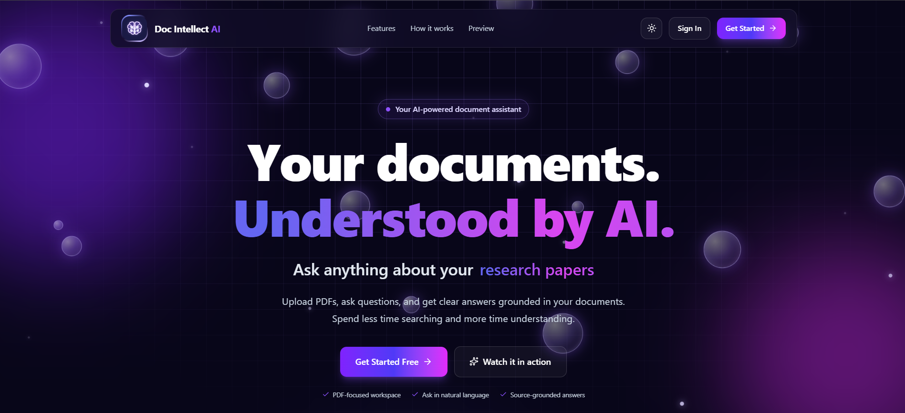
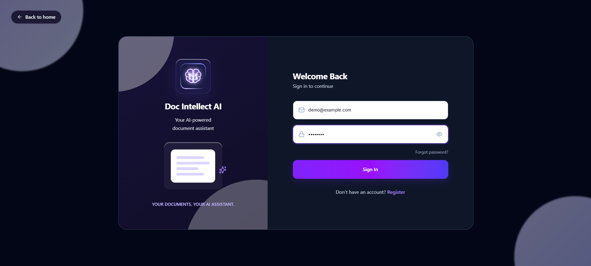
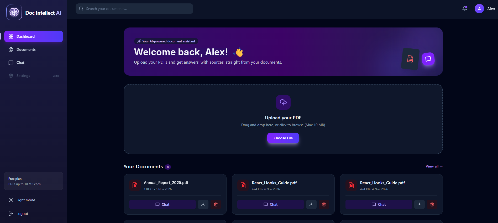
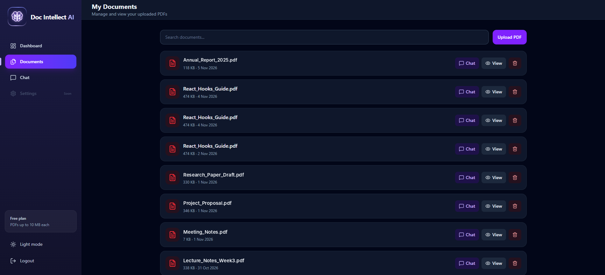
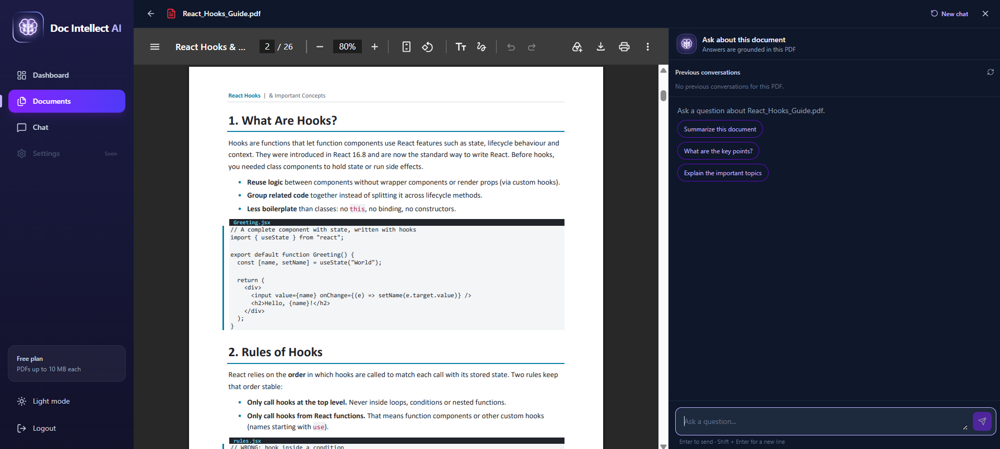
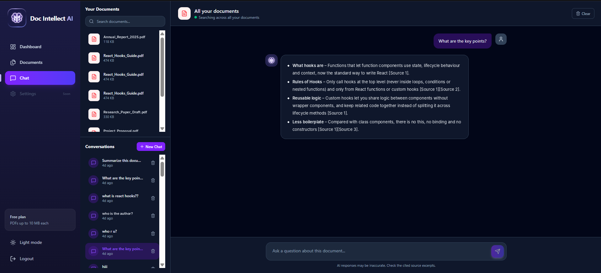
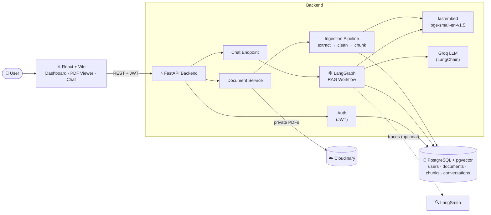
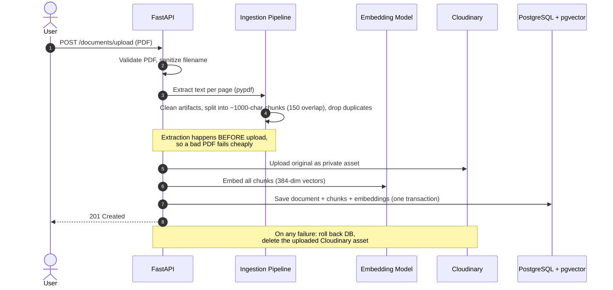
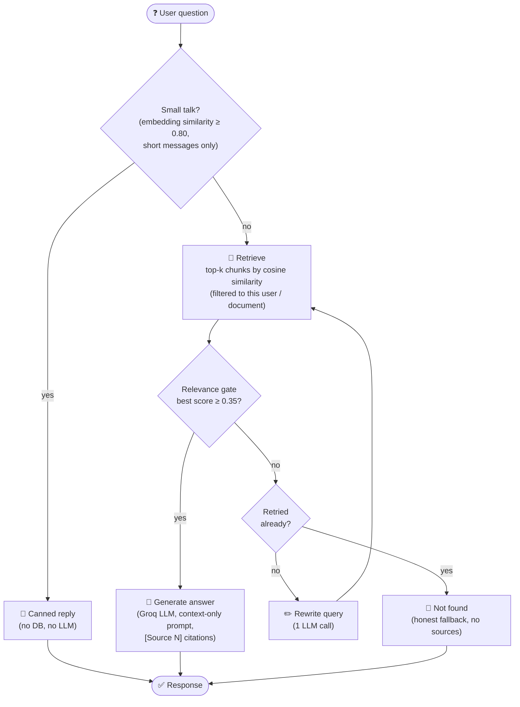

<div align="center">

# 📄 Doc Intellect AI

### Chat with your PDFs. Get answers grounded in your documents, with page-level sources.

An AI-powered document assistant built with **Retrieval-Augmented Generation (RAG)**, **FastAPI**, **LangChain**, **LangGraph** and **React**.

[](https://doc-intellect-ai.vercel.app)


</div>

---

## 📖 Table of Contents

- [Overview](#-overview)
- [Why This Project](#-why-this-project)
- [Key Features](#-key-features)
- [Screenshots](#-screenshots)
- [Tech Stack](#-tech-stack)
- [System Architecture](#-system-architecture)
- [How the RAG Pipeline Works](#-how-the-rag-pipeline-works)
- [LangChain, LangGraph, LangSmith and RAG: What Each Does Here](#-langchain-langgraph-langsmith-and-rag-what-each-does-here)
- [Engineering Highlights](#-engineering-highlights)
- [Backend Project Structure](#-backend-project-structure)
- [Data Model](#-data-model)
- [API Reference](#-api-reference)
- [Getting Started](#-getting-started)
- [Environment Variables](#-environment-variables)
- [Database and Migrations](#-database-and-migrations)
- [Docker](#-docker)
- [Usage](#-usage)
- [Security](#-security)
- [Implementation Status](#-implementation-status)
- [Future Improvements](#-future-improvements)
- [Contributing](#-contributing)
- [Author](#-author)

---

## 🔎 Overview

**Doc Intellect AI** lets you upload a PDF and ask questions about it in plain English. Instead of scrolling through a 60-page report, contract or resume, you ask *"What does this document say about X?"* and get a concise answer **with references to the exact pages it came from**.

Under the hood it uses **Retrieval-Augmented Generation (RAG)**. Rather than letting a language model answer from its general knowledge (where it can make things up), the system first **retrieves the most relevant passages** from *your* document and then asks the model to answer **only from those passages**. If the document doesn't contain the answer, the assistant says so instead of guessing.

> 💡 **In one sentence:** a full-stack, production-minded RAG application that turns static PDFs into a searchable, conversational knowledge source.

---

## 🎯 Why This Project

Reading long documents to find one fact is slow, and asking a general chatbot about a private document is unreliable. This project explores how to build an assistant that is:

- **Grounded:** answers come only from the uploaded document.
- **Verifiable:** every answer shows its source passages and page numbers.
- **Private:** each user can only ever see and query their own documents.
- **Efficient:** simple messages like "hi" or "thanks" never touch the database or the LLM.

---

## ✨ Key Features

### 🔐 Authentication and Accounts
- User registration and login with **JWT** access tokens.
- Passwords stored as **hashes**, never in plain text.
- Every document, conversation and chunk is scoped to its owner; protected endpoints require a valid token.

### 📁 Document Management
- Upload PDFs with server-side validation and filename sanitization.
- List, view, **replace** and **delete** documents.
- Originals are stored in **Cloudinary** as *private, authenticated* assets (not publicly reachable).
- Short-lived **signed URLs** for access, plus a server-side PDF proxy endpoint for the in-app viewer.

### 🤖 AI Document Chat
- Ask natural-language questions about a document.
- Answers are generated from retrieved passages only, with `[Source N]` citations.
- Each answer returns its **source chunks and page numbers**.
- Conversations and messages are **persisted** and can be listed, reopened and deleted.
- The retrieval layer can scope a question to one document or search across all of a user's documents.

### 🧠 Smart Query Handling (LangGraph)
- **Small-talk routing:** greetings, thanks, "who are you?" and similar are answered instantly without retrieval or an LLM call.
- **Relevance gate:** if the best retrieved passage scores too low, the system does not answer from weak evidence.
- **Query rewriting with one retry:** weak retrieval triggers a single LLM rewrite of the search query, then a second attempt.
- **Honest fallback:** if nothing relevant is found, the assistant replies that it couldn't find the information, and shows no sources.

### 🖥️ Frontend Experience
- React single-page app with a landing page, sign-in/register screens and a dashboard for uploaded documents.
- **Drag-and-drop upload** (up to 10 MB per PDF) and a searchable document list.
- **PDF viewer alongside an AI assistant panel**, with one-click starter questions such as *"Summarize this document"*.
- A dedicated **Chat page** that can search **across all your documents**, with a sidebar of past conversations.
- AI answers rendered as **Markdown** (lists, headings, code blocks, tables via GFM).
- **Dark and light themes.**

---

## 📸 Screenshots

> All screenshots use a demo account and sample documents.

### Landing page


### Sign in


### Dashboard: upload a PDF and see your documents


### My Documents: chat, view or delete any PDF


### Document workspace: PDF viewer next to the AI assistant


### Chat across all your documents, with cited sources


---

## 🧰 Tech Stack

| Layer | Technology | Purpose |
|---|---|---|
| **Backend** | Python 3.13, FastAPI, Uvicorn | REST API |
| **ORM / Migrations** | SQLAlchemy, Alembic | Database models and schema versioning |
| **Validation / Config** | Pydantic, Pydantic Settings | Request/response schemas, environment-based config |
| **Auth** | JWT, OAuth2 password flow | Stateless authentication |
| **LLM Inference** | Groq API (default model `openai/gpt-oss-120b`) | Answer generation and query rewriting |
| **Orchestration** | LangChain, LangGraph | Prompting, text splitting, stateful RAG workflow |
| **Observability** | LangSmith (optional) | Tracing and debugging of AI workflows |
| **Embeddings** | `fastembed` with `BAAI/bge-small-en-v1.5` (384-dim) | Local text embeddings, no external API call |
| **PDF Parsing** | `pypdf` | Per-page text extraction |
| **Vector Search** | PostgreSQL + **pgvector** (cosine distance) | Semantic retrieval |
| **Database Host** | PostgreSQL / Supabase | Relational and vector data |
| **File Storage** | Cloudinary (private/authenticated raw assets) | Original PDF storage |
| **Frontend** | React 19, Vite, Tailwind CSS 4, React Router, Axios | UI |
| **Markdown** | `react-markdown`, `remark-gfm` | Rendering AI answers |
| **DevOps** | Docker, `uv`, GitHub Actions | Containerization, dependency management, CI |

---

## 🏗️ System Architecture



**In short:** the React app talks to a FastAPI backend over REST. Uploaded PDFs are parsed, chunked and embedded locally, with the vectors stored in PostgreSQL via pgvector and the original file stored privately in Cloudinary. Questions run through a LangGraph workflow that retrieves relevant chunks and asks a Groq-hosted LLM to answer from them.

---

## 🔄 How the RAG Pipeline Works

### 1. Ingestion: what happens when you upload a PDF



| Step | Details |
|---|---|
| **Extract** | `pypdf` reads each page; empty pages are dropped. Password-protected PDFs and PDFs with no extractable text (e.g. pure scans) are rejected with a clear error. |
| **Clean** | Stray web-citation artifacts (like `【4†L1-L5】`) are stripped from page text. |
| **Chunk** | `RecursiveCharacterTextSplitter`, chunk size **1000**, overlap **150**, splitting on paragraphs, then lines, then sentences. Each chunk keeps its **page number**. |
| **Deduplicate** | Chunks are fingerprinted with SHA-256 (after normalizing case and whitespace) so repeated passages are stored once. |
| **Embed** | `BAAI/bge-small-en-v1.5` runs **locally** via `fastembed`, producing 384-dimension vectors. |
| **Store** | Chunk text, page number, owner and embedding go into PostgreSQL (pgvector). |

### 2. Question answering: the LangGraph workflow



The graph state tracks the question, user, optional document, rewritten search query, retry count, retrieved chunks, the final answer and its sources.

**Prompt design:** the system prompt tells the model to use *only* the provided context, to refer to a document's author in the third person, to reply with a fixed "couldn't find" sentence when the context lacks the answer, to cite only sources it actually used, and to **treat the document text as untrusted** and ignore any instructions that appear inside it (a basic defense against prompt injection through uploaded files).

---

## 🧩 LangChain, LangGraph, LangSmith and RAG: What Each Does Here

| Technology | Role in this project |
|---|---|
| **RAG** | The core idea. Retrieve relevant passages from the user's own document first, then generate an answer from them. This reduces hallucination and makes answers checkable against sources. |
| **LangChain** | The building blocks: `RecursiveCharacterTextSplitter` for chunking, `ChatPromptTemplate` for prompts, and `ChatGroq` to call the LLM. |
| **LangGraph** | Turns the Q&A flow into an explicit, stateful graph with branches and a loop (routing, relevance gate, retry-with-rewrite, fallback) instead of a straight line of function calls. This makes the logic easy to reason about, test and extend. |
| **LangSmith** | Optional tracing. With tracing enabled via environment variables, each graph run can be inspected step by step, which is useful for tuning the relevance threshold and prompts. |

---

## 🛠️ Engineering Highlights

A few design decisions worth calling out:

- **Cost-aware AI flow.** Small talk is handled with embedding similarity (no LLM call), retrieval uses *local* embeddings (no API cost), and the LLM is called only when there is relevant context. A failed retrieval allows at most **one** rewrite call.
- **Honesty over fluency.** A relevance threshold plus a strict "answer only from context" prompt means the assistant prefers *"I couldn't find this"* over a confident guess. Refusals never display sources.
- **Per-user isolation at the query level.** Vector search is always filtered by `user_id` (and optionally `document_id`), so one user's chunks can never be retrieved for another user.
- **Transactional uploads with cleanup.** Text is extracted *before* the file is uploaded, DB writes happen in one transaction, and a failure rolls back and deletes the uploaded Cloudinary asset. On replace, the old file is removed only *after* the new data is committed; on delete, the DB row is removed *before* the stored file.
- **Private file storage.** PDFs are uploaded as Cloudinary `authenticated` assets under per-user paths. Access goes through short-lived signed URLs or a server-side proxy that sends `Cache-Control: private, no-store`.
- **Clean layering.** Routers → services → graph nodes, with Pydantic schemas at the edges and settings centralized in one config class.
- **Reproducible deployment.** A Docker image built with `uv` and a lockfile, running as a non-root user, applying migrations automatically on start.

---

## 🗂️ Backend Project Structure

```text
backend/
├── app/
│   ├── core/                      # Config, DB session, security (JWT/hashing), dependencies,
│   │                              # logging, Cloudinary setup, upload validation
│   ├── models/                    # SQLAlchemy models: User, Document, DocumentChunk,
│   │                              # Conversation, ChatMessage
│   ├── schemas/                   # Pydantic request/response schemas
│   ├── routers/
│   │   ├── auth.py                # /auth  (register, login)
│   │   ├── users.py               # /users (current user)
│   │   ├── documents.py           # /documents (upload, list, view, replace, delete)
│   │   ├── chat.py                # /chat (ask a question)
│   │   └── conversations.py       # /conversations (history)
│   ├── services/
│   │   ├── auth.py                # register / authenticate users
│   │   ├── document_service.py    # document records
│   │   ├── text_extraction.py     # PDF → pages (pypdf)
│   │   ├── chunking.py            # splitting + de-duplication
│   │   ├── ingestion_pipeline.py  # extract → clean → chunk
│   │   ├── embedding_service.py   # fastembed (bge-small-en-v1.5)
│   │   ├── chunk_storage.py       # embed + persist chunks
│   │   ├── retrieval_service.py   # pgvector cosine-similarity search
│   │   ├── router_service.py      # small-talk detection
│   │   ├── query_rewrite_service.py
│   │   ├── generation_service.py  # prompt + Groq LLM
│   │   └── cloudinary_storage.py  # upload / signed URL / delete
│   ├── graphs/
│   │   ├── state.py               # RAGState
│   │   ├── nodes.py               # routing, retrieval, gate, rewrite, generate
│   │   └── rag_graph.py           # LangGraph assembly
│   └── main.py                    # FastAPI entry point
├── alembic/                       # Migration environment
├── Dockerfile
├── pyproject.toml / uv.lock       # Dependencies (managed with uv)
└── .env                           # Local secrets (never commit)
```

---

## 🗄️ Data Model

| Model | Purpose | Notable fields |
|---|---|---|
| **User** | Account | email, full name, hashed password, active flag, created timestamp |
| **Document** | An uploaded PDF | owner, filename, Cloudinary public ID (`file_path`), file type, file size |
| **DocumentChunk** | A searchable passage | owner, document, chunk index, text content, page number, **embedding vector (384-dim)** |
| **Conversation** | A chat thread | owner, optional document, title, timestamps |
| **ChatMessage** | One message in a thread | conversation, role (`user` / `assistant`), content |

---

## 📡 API Reference

Interactive docs are generated by FastAPI. With the backend running, open:

- **Swagger UI:** `http://localhost:8000/docs`
- **ReDoc:** `http://localhost:8000/redoc`

| Method | Endpoint | Auth | Description |
|---|---|:---:|---|
| `GET` | `/` | No | Welcome message and status |
| `GET` | `/health` | No | Health check (verifies DB connectivity) |
| `POST` | `/auth/register` | No | Create an account |
| `POST` | `/auth/login` | No | Log in (form fields `username` = email, `password`); returns a bearer token |
| `GET` | `/users/me` | ✅ | Current user's profile |
| `POST` | `/documents/upload` | ✅ | Upload and ingest a PDF |
| `GET` | `/documents/` | ✅ | List your documents |
| `GET` | `/documents/{document_id}` | ✅ | Get one document's metadata |
| `GET` | `/documents/{document_id}/file` | ✅ | Get a temporary signed URL (valid 300 s) |
| `GET` | `/documents/{document_id}/view` | ✅ | Stream the PDF inline through the backend |
| `PUT` | `/documents/{document_id}/file` | ✅ | Replace a document's PDF and re-index it |
| `DELETE` | `/documents/{document_id}` | ✅ | Delete a document, its chunks and stored file |
| `POST` | `/chat/ask` | ✅ | Ask a question; returns answer, sources and `conversation_id` |
| `GET` | `/conversations/` | ✅ | List conversations (optional `document_id` filter) |
| `GET` | `/conversations/{conversation_id}` | ✅ | Get a conversation with its messages |
| `DELETE` | `/conversations/{conversation_id}` | ✅ | Delete a conversation |

**Quick example**

```bash
# 1. Register
curl -X POST http://localhost:8000/auth/register \
  -H "Content-Type: application/json" \
  -d '{"email": "you@example.com", "full_name": "Your Name", "password": "your-password"}'

# 2. Log in (form-encoded)
curl -X POST http://localhost:8000/auth/login \
  -d "username=you@example.com&password=your-password"

# 3. Upload a PDF
curl -X POST http://localhost:8000/documents/upload \
  -H "Authorization: Bearer <ACCESS_TOKEN>" \
  -F "file=@/path/to/document.pdf"

# 4. Ask a question
curl -X POST http://localhost:8000/chat/ask \
  -H "Authorization: Bearer <ACCESS_TOKEN>" \
  -H "Content-Type: application/json" \
  -d '{"question": "What is this document about?", "document_id": 1}'
```

---

## 🚀 Getting Started

### Prerequisites

- **Python 3.13** and [**uv**](https://docs.astral.sh/uv/)
- **Node.js** (current LTS recommended) and npm
- A **PostgreSQL** database with the **pgvector** extension available (Supabase works out of the box)
- A **Groq** API key
- A **Cloudinary** account
- *(Optional)* A **LangSmith** API key for tracing

### 1. Clone the repository

```bash
git clone https://github.com/AryaDeb1234/Doc-Intellect-AI.git
cd Doc-Intellect-AI
```

### 2. Backend

```bash
cd backend

# Install dependencies from pyproject.toml / uv.lock
uv sync

# Create your environment file (see "Environment Variables" below)
# and fill in real values. Never commit this file.
touch .env

# Apply database migrations
uv run alembic upgrade head

# Start the API (auto-reload for development)
uv run uvicorn app.main:app --reload --port 8000
```

The API is now at `http://localhost:8000`, with docs at `http://localhost:8000/docs`.

> ℹ️ The first request that needs embeddings downloads the `bge-small-en-v1.5` model and caches it, so it can take a little longer.

### 3. Frontend

```bash
cd frontend
npm install
npm run dev
```

Vite serves the app on `http://localhost:5173`, which is already included in the backend's default CORS origins.

<!-- TODO: if the frontend reads the API base URL from an env variable (e.g. VITE_...),
     document its exact name here and add a frontend/.env.example. -->

Other frontend scripts: `npm run build`, `npm run preview`, `npm run lint`.

---

## 🔑 Environment Variables

Create `backend/.env`. **Use placeholders in anything you commit; keep real values private.**

```env
# ---------- Required ----------
DATABASE_URL=postgresql+psycopg://<user>:<password>@<host>:5432/<database>
GROQ_API_KEY=<your-groq-api-key>
JWT_SECRET_KEY=<long-random-string>
CLOUDINARY_CLOUD_NAME=<your-cloud-name>
CLOUDINARY_API_KEY=<your-cloudinary-api-key>
CLOUDINARY_API_SECRET=<your-cloudinary-api-secret>

# ---------- Optional (defaults shown) ----------
APP_NAME=Doc Intellect AI
APP_ENV=development
LOG_LEVEL=INFO
LLM_MODEL=openai/gpt-oss-120b
LLM_TEMPERATURE=0.3
LLM_MAX_TOKENS=1024
JWT_ALGORITHM=HS256
ACCESS_TOKEN_EXPIRE_MINUTES=30
CORS_ORIGINS=http://localhost:5173,http://127.0.0.1:5173

# ---------- Optional: LangSmith tracing ----------
LANGSMITH_TRACING=true
LANGSMITH_API_KEY=<your-langsmith-api-key>
LANGSMITH_PROJECT=<your-project-name>
```

| Variable | Required | Default | Description |
|---|:---:|---|---|
| `DATABASE_URL` | ✅ | — | PostgreSQL connection string (SQLAlchemy URL, `psycopg` driver) |
| `GROQ_API_KEY` | ✅ | — | Groq API key for the LLM |
| `JWT_SECRET_KEY` | ✅ | — | Secret used to sign JWTs |
| `CLOUDINARY_CLOUD_NAME` | ✅ | — | Cloudinary cloud name |
| `CLOUDINARY_API_KEY` | ✅ | — | Cloudinary API key |
| `CLOUDINARY_API_SECRET` | ✅ | — | Cloudinary API secret |
| `APP_NAME` | | `Doc Intellect AI` | App title shown in API docs |
| `APP_ENV` | | `development` | Environment label |
| `LOG_LEVEL` | | `INFO` | Logging verbosity |
| `LLM_MODEL` | | `openai/gpt-oss-120b` | Groq model name |
| `LLM_TEMPERATURE` | | `0.3` | Sampling temperature |
| `LLM_MAX_TOKENS` | | `1024` | Max tokens per answer |
| `JWT_ALGORITHM` | | `HS256` | JWT signing algorithm |
| `ACCESS_TOKEN_EXPIRE_MINUTES` | | `30` | Token lifetime |
| `CORS_ORIGINS` | | `http://localhost:5173,http://127.0.0.1:5173` | Comma-separated allowed origins |
| `LANGSMITH_TRACING` / `LANGSMITH_API_KEY` / `LANGSMITH_PROJECT` | | — | Enable LangSmith tracing (read from the environment by LangSmith) |

Generate a strong JWT secret:

```bash
python -c "import secrets; print(secrets.token_urlsafe(48))"
```

---

## 🧱 Database and Migrations

Schema changes are managed with **Alembic**. The migration environment reads `DATABASE_URL` from your settings and tracks the `User`, `Document`, `DocumentChunk`, `Conversation` and `ChatMessage` models.

```bash
cd backend

# Apply all migrations
uv run alembic upgrade head

# After changing a model: generate a new migration, then apply it
uv run alembic revision --autogenerate -m "describe your change"
uv run alembic upgrade head
```

> ℹ️ Embeddings are stored with **pgvector**, so the extension must be enabled on your database. On Supabase it can be turned on from the dashboard's *Extensions* page; on self-hosted Postgres use `CREATE EXTENSION IF NOT EXISTS vector;`.

---

## 🐳 Docker

The backend ships with a `Dockerfile` that:

- uses **`python:3.13-slim`** and installs dependencies with **`uv`** from `pyproject.toml` and `uv.lock`
- caches the embedding model in `/models` (`FASTEMBED_CACHE_PATH`)
- runs as a **non-root user**
- on start, runs **`alembic upgrade head`** and then launches **Uvicorn** on `$PORT` (default `8000`), which suits hosts such as Render that inject a port

**Build and run the backend image**

```bash
# from the repository root
docker build -t doc-intellect-backend ./backend

docker run --rm -p 8000:8000 --env-file backend/.env doc-intellect-backend
```

Then open `http://localhost:8000/docs`.

<!-- TODO: the repo also contains a docker-compose.yml. Paste its services here
     (and the exact `docker compose up` command) once you've confirmed what it runs. -->

**CI:** a GitHub Actions workflow in `.github/workflows/` builds and pushes the backend Docker image.

---

## 🧭 Usage

1. **Create an account** and log in.
2. From the **dashboard**, **upload a PDF**. It is parsed, chunked, embedded and indexed.
3. **Open the document** to see the PDF and the AI assistant side by side.
4. **Ask a question** in plain language, for example:
   - *"Summarize the key points of this document."*
   - *"What skills are listed in this resume?"*
   - *"What does section 3 say about payment terms?"*
5. Read the **answer** (rendered as Markdown) and check the **sources** it cites, including page numbers.
6. Come back later: your **conversations are saved** and can be reopened or deleted.
7. **Replace** a document with a new version or **delete** it, and its stored chunks and file are cleaned up too.

> 💬 If you ask something the document doesn't cover, the assistant will tell you it couldn't find that information rather than guessing.

---

## 🔒 Security

- **Password hashing**; plain-text passwords are never stored.
- **JWT-protected endpoints** for all user data.
- **Ownership checks everywhere:** documents, conversations and vector search are filtered by the authenticated user.
- **Private storage:** PDFs are Cloudinary `authenticated` assets; there are no public file links.
- **Short-lived signed URLs** (300 s for `/file`, 60 s when the backend fetches a PDF for `/view`). Treat them as temporary secrets: don't persist them in browser storage, logs or analytics.
- **No-store caching** on proxied PDF responses.
- **Upload hardening:** PDF validation and filename sanitization before processing.
- **Restricted CORS** (configurable origins, limited methods and headers).
- **Secrets in environment variables**, loaded through Pydantic Settings. Keep `.env` out of version control.
- **Prompt-injection awareness:** retrieved document text is explicitly marked as untrusted in the prompt.

---

## ✅ Implementation Status

| Area | Status |
|---|:---:|
| Registration, login, JWT auth, `/users/me` | ✅ Implemented |
| PDF upload, list, view, replace, delete | ✅ Implemented |
| Private Cloudinary storage and signed URLs | ✅ Implemented |
| Text extraction, cleaning, chunking, de-duplication | ✅ Implemented |
| Local embeddings and pgvector similarity search | ✅ Implemented |
| LangGraph workflow (routing, relevance gate, rewrite + retry, fallback) | ✅ Implemented |
| Answers with `[Source N]` citations and page numbers | ✅ Implemented |
| Persisted conversations and messages | ✅ Implemented |
| Health check, CORS, structured logging | ✅ Implemented |
| Alembic migrations, Dockerfile, GitHub Actions image build | ✅ Implemented |
| React dashboard, PDF viewer + chat panel, Markdown answers | ✅ Implemented |
| Dark / light theme, document search, all-documents chat | ✅ Implemented |
| Settings page | 🗓️ Planned (shown as "Soon" in the UI) |
| LangSmith tracing | 🔧 Optional, enabled through environment variables |
| DOCX / Markdown document ingestion | 🗓️ Planned (extension mapping exists; ingestion is PDF-only today) |

---

## 🔮 Future Improvements

- **Password reset** and a **Settings** page (both are visible in the UI as upcoming).
- **Conversation memory in prompts:** conversations are stored today; feeding recent turns into the prompt would enable follow-up questions like *"and what about the second one?"*
- **More file types:** DOCX and Markdown ingestion.
- **OCR** for scanned PDFs that have no text layer.
- **Streaming responses** for a faster-feeling chat.
- **Better retrieval quality:** hybrid (keyword + vector) search, re-ranking, and threshold tuning guided by LangSmith traces.
- **Evaluation:** a test set of questions and expected answers to measure answer quality over time.
- **Automated tests** and a fuller CI pipeline (lint, tests, build).
- **Rate limiting** and refresh tokens for production hardening.

---

## 🤝 Contributing

Contributions, issues and suggestions are welcome.

1. **Fork** the repository and create a branch: `git checkout -b feature/your-feature`
2. Make your changes, keeping the existing layering (routers → services → graphs).
3. If you change a model, add an **Alembic migration**.
4. **Never commit secrets** (`.env`, API keys, database URLs).
5. Run the frontend linter (`npm run lint`) and make sure the backend starts cleanly.
6. Commit with a clear message and open a **Pull Request** describing what and why.

---

## 👤 Author

**Arya Deb**
BCA student and backend / AI application developer, Kolkata, India

[](https://github.com/AryaDeb1234)

---

<div align="center">

⭐ If you found this project interesting, consider giving it a star.

</div>
